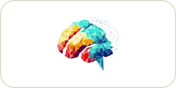
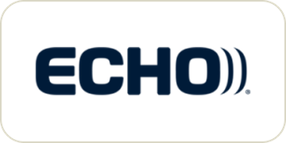
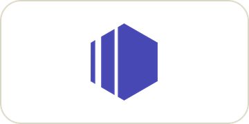
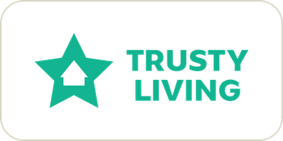

 

<h3 align="center">Hi, I'm Aliyan</h3>

<h1 align="center">Computer Engineer</h1>

  Working as a full-stack AI engineer and team lead. I build scalable products for startups, 
  from retrieval pipelines and LLM workflows to the AWS architecture underneath them.

  
  
  

  <code>Lahore, Pakistan</code>&nbsp;&nbsp;·&nbsp;&nbsp;<code>AWS and distributed systems</code>&nbsp;&nbsp;·&nbsp;&nbsp;<code>Weekends in the mountains</code>

 

## About me

Hi, I'm Aliyan, a computer engineer who likes owning a problem end to end, from the first requirements call to the system running in production.

These days I lead a team building retrieval pipelines, LLM workflows, backend services and the AWS architecture that holds them up. I enjoy the problems that do not fit neatly into one category, and I care about shipping things people actually use.

## Tech stack

   
   
  

  
  
  
  
  
  
  
  
  
  

## Selected work

<table>
  <tr>
    <td width="50%" valign="top">
       
      
      <h3><a href="https://www.pocketcoachcommunity.com">Pocket Coach</a></h3>
      <b>SOCIAL LEARNING PLATFORM</b>
      
A coaching community built across three surfaces: a React Native app, a Next.js admin dashboard and a NestJS backend. Video feed, real-time chat, Stripe Connect payouts, and uploads that go from the phone to S3 to a CDN without touching the API.

      
<code>React Native</code> <code>NestJS</code> <code>Next.js</code> <code>PostgreSQL</code> <code>Redis</code> <code>AWS</code>

      <a href="https://www.pocketcoachcommunity.com"><b>Visit site ↗</b></a>
        
    </td>
    <td width="50%" valign="top">
       
      
      <h3><a href="https://tbm-automation.com">TBM</a></h3>
      <b>COST INTELLIGENCE</b>
      
Technology business management for IT finance teams. Background jobs ingest raw spend spreadsheets and map them to a cost taxonomy, so the multi-tenant dashboard stays fast during heavy imports.

      
<code>React</code> <code>Radix UI</code> <code>Express</code> <code>MongoDB</code> <code>BullMQ</code> <code>OpenAI</code>

      <a href="https://tbm-automation.com"><b>Visit site ↗</b></a>
        
    </td>
  </tr>
  <tr>
    <td width="50%" valign="top">
       
      
      <h3>TryEcho</h3>
      <b>RETRIEVAL AND STREAMING</b>
      
Meeting transcripts and long videos in, LinkedIn posts in the user's own voice out. LangGraph agents run the workflow, vector search grounds each draft, and SSE streams tokens as they generate.

      
<code>LangGraph</code> <code>RAG</code> <code>Qdrant</code> <code>SSE</code> <code>Multi-LLM routing</code> <code>Stripe</code>

      <b>Private product, walkthrough on request</b>
        
    </td>
    <td width="50%" valign="top">
       
      
      <h3><a href="https://leomansclothing.store">Leomans</a></h3>
      <b>ECOMMERCE</b>
      
A clothing store built end to end: a Next.js storefront and admin dashboard over an Express and MongoDB API, with Stripe checkout, S3 uploads and product-level SEO.

      
<code>Next.js</code> <code>TanStack Query</code> <code>Zustand</code> <code>Express</code> <code>MongoDB</code> <code>Stripe</code>

      <a href="https://leomansclothing.store"><b>Visit site ↗</b></a>
        
    </td>
  </tr>
  <tr>
    <td width="50%" valign="top">
       
      
      <h3><a href="https://www.groupups.com">GroupUps</a></h3>
      <b>CONVERSATIONAL AI</b>
      
An AI buying assistant that guides dental equipment buyers through an admin-defined question flow. I built the real-time admin notifications, chat history and admin editing tools.

      
<code>React</code> <code>Zustand</code> <code>Socket.IO</code> <code>Express</code> <code>OpenAI</code>

      <a href="https://www.groupups.com"><b>Visit site ↗</b></a>
        
    </td>
    <td width="50%" valign="top">
       
      
      <h3><a href="https://cloudacytech.com">Cloudacy</a></h3>
      <b>SECURE HANDOVER</b>
      
Encrypted storage for digital assets with a dead-man's-switch handover to trustees and beneficiaries. A React web app, a React Native mobile app and an Express and Prisma backend.

      
<code>React</code> <code>React Native</code> <code>Express</code> <code>Prisma</code> <code>PostgreSQL</code> <code>S3</code>

      <a href="https://cloudacytech.com"><b>Visit site ↗</b></a>
        
    </td>
  </tr>
  <tr>
    <td width="50%" valign="top">
       
      
      <h3><a href="https://customairesumebuilder.com">AI Resume Builder</a></h3>
      <b>DOCUMENT GENERATION</b>
      
Parses a resume and a job description, then rewrites one against the other with a LangGraph and OpenAI pipeline. Live editing in the browser and PDF export.

      
<code>LangGraph</code> <code>OpenAI</code> <code>React</code> <code>Express</code> <code>Prisma</code> <code>Puppeteer</code>

      <a href="https://customairesumebuilder.com"><b>Visit site ↗</b></a>
        
    </td>
    <td width="50%" valign="top">
       
      
      <h3><a href="https://ancdiasporainfo.com">ANC Diaspora</a></h3>
      <b>PAYMENTS AND EVENTS</b>
      
A community platform for a diaspora organisation: convention registration, recurring donations and campaign contributions on Stripe, with event management and volunteer coordination.

      
<code>Next.js</code> <code>MongoDB</code> <code>Stripe</code> <code>Nodemailer</code>

      <a href="https://ancdiasporainfo.com"><b>Visit site ↗</b></a>
        
    </td>
  </tr>
  <tr>
    <td width="50%" valign="top">
       
      
      <h3><a href="https://www.trustyliving.com">Trusty Living</a></h3>
      <b>REVIEW MARKETPLACE</b>
      
A "Yelp for rentals" where tenants review landlords, neighbourhoods and agents before signing a lease, with map-based property search and landlord rankings.

      
<code>Next.js</code> <code>Radix UI</code> <code>Zustand</code> <code>Tailwind</code> <code>Google Maps</code>

      <a href="https://www.trustyliving.com"><b>Visit site ↗</b></a>
        
    </td>
    <td width="50%" valign="middle" align="center">
      <h3>See more</h3>
      
Full write-ups of each project are on my portfolio.

      
    </td>
  </tr>
</table>
