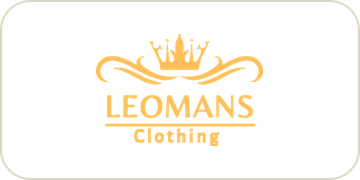
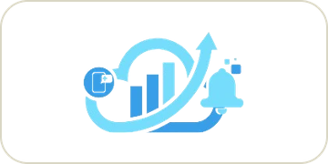
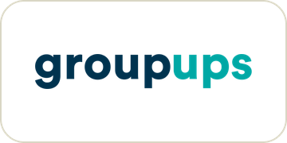

<a href="https://aliyanjamshaid.com">
  
</a>

<p align="center">
  <picture>
    <source media="(prefers-color-scheme: dark)" srcset="https://readme-typing-svg.demolab.com?font=JetBrains+Mono&weight=500&size=20&duration=2800&pause=900&color=82AAFF&center=true&vCenter=true&width=640&lines=I+build+AI+agents+and+RAG+pipelines;Real-time+web+and+mobile+products;React+%C2%B7+Next.js+%C2%B7+Node.js+%C2%B7+AWS" />
    
  </picture>
</p>

<p align="center">
  <a href="https://aliyanjamshaid.com"></a>
  <a href="https://www.linkedin.com/in/aliyan-jamshaid/"></a>
  <a href="mailto:aliyanjamshaid789@gmail.com"></a>
</p>

<br />

## About me

```ts
const aliyan = {
  role: "Full-stack & AI engineer, team lead",
  based: "Lahore, Pakistan (UTC+5)",
  clients: ["United States", "United Kingdom"],
  builds: ["AI agents & RAG", "real-time web & mobile apps", "AWS media & data pipelines"],
  team: "Lead two engineers: architecture standards and code review",
};
```

## Tech stack

<p align="center">
  <br />
  <br />
  
</p>

<p align="center">
  
  
  
  
  
  
  
  
  
  
</p>

## Projects

<table>
  <tr>
    <td width="33%" align="center" valign="top">
      <a href="https://www.pocketcoachcommunity.com"></a>
      <h3><a href="https://www.pocketcoachcommunity.com">Pocket Coach</a></h3>
      <p>Coaching community app with a video feed, real-time chat and a phone-to-CDN media pipeline.</p>
      <code>React Native</code> <code>NestJS</code> <code>AWS</code>
    </td>
    <td width="33%" align="center" valign="top">
      
      <h3>TryEcho <sub>(private)</sub></h3>
      <p>Turns meeting transcripts into LinkedIn posts in the user's own voice, streamed live.</p>
      <code>LangGraph</code> <code>RAG</code> <code>SSE</code>
    </td>
    <td width="33%" align="center" valign="top">
      <a href="https://tbm-automation.com"></a>
      <h3><a href="https://tbm-automation.com">TBM</a></h3>
      <p>Multi-tenant cost dashboard for IT finance teams that stays fast during heavy data imports.</p>
      <code>React</code> <code>BullMQ</code> <code>OpenAI</code>
    </td>
  </tr>
  <tr>
    <td width="33%" align="center" valign="top">
      <a href="https://leomansclothing.store"></a>
      <h3><a href="https://leomansclothing.store">Leomans</a></h3>
      <p>Clothing store built end to end: storefront, admin dashboard, API and Stripe checkout.</p>
      <code>Next.js</code> <code>Express</code> <code>MongoDB</code>
    </td>
    <td width="33%" align="center" valign="top">
      <a href="https://cloudacytech.com"></a>
      <h3><a href="https://cloudacytech.com">Cloudacy</a></h3>
      <p>Encrypted storage for digital assets, handed to trustees and beneficiaries at the right time.</p>
      <code>React Native</code> <code>Prisma</code> <code>S3</code>
    </td>
    <td width="33%" align="center" valign="top">
      <a href="https://ancdiasporainfo.com"></a>
      <h3><a href="https://ancdiasporainfo.com">ANC Diaspora</a></h3>
      <p>Community platform for donations, event registration and volunteers.</p>
      <code>Next.js</code> <code>Stripe</code> <code>MongoDB</code>
    </td>
  </tr>
  <tr>
    <td width="33%" align="center" valign="top">
      <a href="https://customairesumebuilder.com"></a>
      <h3><a href="https://customairesumebuilder.com">AI Resume Builder</a></h3>
      <p>Rewrites a resume against a job description, with PDF export.</p>
      <code>LangGraph</code> <code>OpenAI</code> <code>Prisma</code>
    </td>
    <td width="33%" align="center" valign="top">
      <a href="https://www.trustyliving.com"></a>
      <h3><a href="https://www.trustyliving.com">Trusty Living</a></h3>
      <p>Rental reviews of landlords and neighbourhoods, with map search.</p>
      <code>Next.js</code> <code>Zustand</code> <code>Maps</code>
    </td>
    <td width="33%" align="center" valign="top">
      <a href="https://www.groupups.com"></a>
      <h3><a href="https://www.groupups.com">GroupUps</a></h3>
      <p>AI buying assistant for dental equipment, with real-time admin notifications.</p>
      <code>React</code> <code>Socket.IO</code> <code>OpenAI</code>
    </td>
  </tr>
</table>

<p align="center">
  More on <a href="https://aliyanjamshaid.com"><b>aliyanjamshaid.com</b></a>
</p>


